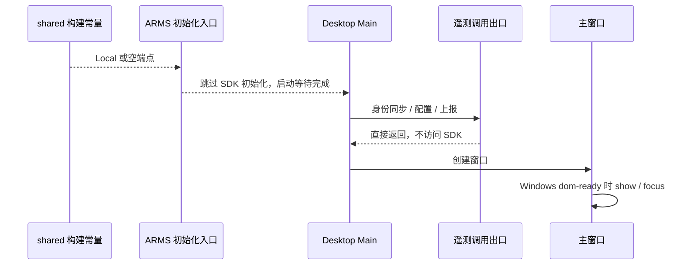

# 桌面构建期可选能力

## 目标

三项能力由构建期配置决定是否启用，未配置时一律关闭：

| 能力 | 配置项 | 关闭时的行为 |
| --- | --- | --- |
| ARMS RUM 上报 | `ZCODE_ARMS_RUM_ENDPOINT` | 主进程与渲染进程跳过 ARMS SDK 初始化；配置、身份同步及上报出口短路，不产生上报 |
| 事件上报（数仓） | `ZCODE_TELEMETRY_REPORT_ENDPOINT` | 遥测事件在发送前直接返回 |
| 自动更新 | `ZCODE_AUTO_UPDATE`（`1`、`true`、`yes` 为启用） | 与 Preview 形态相同，不检查、不下载更新 |

这样同一份源码可以产出“默认不上报、不自动更新”的构建，也可以产出启用这些能力的正式构建，
不需要在源码里写死上报地址。

## 配置来源与优先级

1. 构建进程的环境变量。显式设置为空字符串表示关闭。
2. `config/private/build-defaults.json`。只存在于内部仓库，开源导出不包含。
3. 以上都没有时关闭。

## 所有者与数据流

```
环境变量 / config/private/build-defaults.json
        │ scripts/build-time-config.mjs（唯一解析入口）
        ▼
desktop tsup（main、host、preload）与 desktop vite（renderer）的 define
        │ __ZCODE_ARMS_RUM_ENDPOINT__ / __ZCODE_TELEMETRY_REPORT_ENDPOINT__ / __ZCODE_AUTO_UPDATE_ENABLED__
        ▼
@zcode/shared env 常量 ── 运行时代码只读这些常量
```

- 未注入 define 的环境（测试、其他 bundle）得到关闭值；vitest 为测试注入固定的事件上报端点，以便验证上报链路。
- 自动更新在 Desktop Main 启动时判定：`ZCODE_PRODUCT_FLAVOR === "production" && ZCODE_AUTO_UPDATE_ENABLED`。
- Local 产品身份强制关闭三项能力，构建环境中的端点不能覆盖这一边界。
- Desktop Main 的业务调用统一经过 `desktopArmsTelemetry.ts`；只有 `appARMSBootstrap.ts` 负责真实 SDK 初始化及 reporter 装配。端点为空、Local 或启动时产品请求禁用信号开启时，业务调用不得读取 SDK 未初始化的配置，也不得注册 reporter。
- Local 不因继承系统 OTLP 环境而创建 Renderer exporter；`ZCODE_DISABLE_PRODUCT_ENDPOINT` 和 `OTEL_SDK_DISABLED=true` 也必须在创建 exporter 前生效。关闭 ARMS 时不注入 Browser perf 补发脚本，也不轮询或改写 preload Bridge。
- 本地日志、崩溃诊断、资源管理及 E2E 内存捕获继续可用；仅用于上报的数据目录扫描和远程定时上报不在关闭时启动。
- Agent 的 OTLP 遥测沿用既有机制，由打包环境的 `ZCODE_PACKAGED_AGENT_OTEL_*` 注入，不在本文件范围内。

## 关闭遥测时的启动顺序



SDK 初始化入口拥有初始化时序；业务出口只读同一构建常量及启动时产品请求禁用信号，不维护第二份启用状态。托盘驻留设置只控制关窗行为，正常双击启动必须继续创建并显示主窗口。

## 验收

1. 内部仓库存在私有默认配置时，构建结果与改造前一致：ARMS、事件上报、自动更新均启用，地址不变。
2. 没有私有默认配置、也没有环境变量时，三项均关闭。
3. 环境变量优先于私有默认配置，显式空字符串可以关闭单项能力。
4. Windows 正常双击冷启动时即使遥测关闭，身份同步与稳定性/资源/网络配置均不抛出 `Config not initialized`，主窗口正常显示；已有驻留窗口仍可通过再次双击或托盘唤出。
5. Local 即使存在构建期上报端点，也不初始化 SDK、不装配 reporter；数据库启动、MCP、远程连接、Renderer 自定义上报不触发真实 SDK，关闭时不启动上报专用扫描/定时器，本地诊断继续可用。
6. 显式启用且非 Local 的构建保留原 SDK 参数与接收者，ARMS 端点不依赖数仓端点是否启用。
7. 类型检查、Lint 与相关单测通过；当前 macOS 环境下的单元回归不能替代 Windows 安装包真机验收。


## 关闭遥测启动回归验证

- 对照合并前、上游与合并后源码：旧 Local 版本同时保护 SDK 初始化与身份/配置调用；上游以禁用上报的方式初始化配置。合并后保留跳过初始化，却移除了调用保护，导致创建托盘后的身份同步抛错并中断首窗启动。
- 回归在修复前复现关闭端点与 Local 端点覆盖时仍访问 SDK reporter；修复后 17 个测试文件、197 项回归通过。严格 SDK mock 覆盖未初始化配置抛错、关闭时零 SDK 调用、显式启用时参数及接收者转发；Windows 首窗 dom-ready 显示/聚焦及托盘唤回用例通过。
- 数据库、MCP、资源/网络指标、远程连接、Renderer exporter、preload 监听及 ARMS Browser 关闭边界通过；Local 或禁用信号下即使继承系统 OTLP 地址，也不构造 exporter。
- 新增调用出口、相关页面辅助代码与新增边界回归的 TypeScript 检查通过；根 Lint 为 0 errors / 72 warnings，架构检查为 0 违规。
- 根 `pnpm typecheck` 已实际执行，因完整工作区依赖与 WDIO/Mocha 等类型此前被清理而失败，不作为本轮全项目通过证据。
- 本轮未下载或运行 Electron 二进制，未执行 Windows 安装包真机冷启动；单元用例验证 Windows 代码分支。验证工具、依赖与新增编译产物在结束时清理，原有产物保留。
