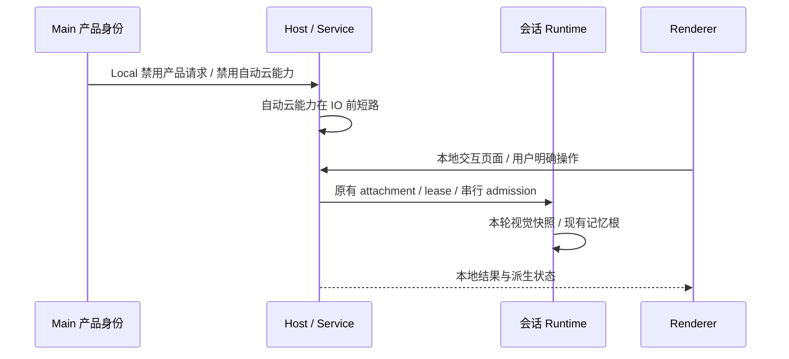
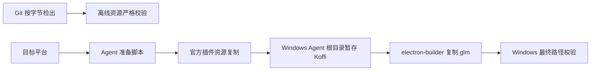

# v3.15.1 上游合并与内网边界

## 产品规则

- 合并上游 `aac47556` 的本地 UI Plugin、Gen UI / Visualize、Hook 信任、运行时及回归工具改进。
- 保留 Local 产品身份、独立数据根、自定义模型列表、生成速度、视觉助手和项目记忆一次性迁移。用户级 Hook 配置、默认信任记录与全局保存工作流跟随同一数据根；用户明确设置的 storage.dir 仍优先，~/ 按真实家目录展开。
- 应用自身不得恢复官方账号登录、套餐、营销内容、奖励、反馈上传、云分享、自动更新、公共插件目录/资源下载、ARMS 或外部遥测。既有 Bots 与手机远控退役边界保持不变；仅保留输入来源等纯协议 schema 供历史消息解析，不注册机器人服务或网络执行器。
- 用户明确选择的模型地址、浏览器导航、WebFetch、MCP 和普通内容外链保留；此限制不作为用户访问公网的全局网络防火墙。
- 图表与地图使用固定版本的 D3、TopoJSON 和世界/美国边界数据，并随包携带资源哈希及许可证；桌面内联与独立 HTML 导出共用清单。
- 新内置技能及交互页面随包离线交付，初始化、展示和恢复不依赖 CDN。Gen UI 仅将固定脚本映射至随包资源，其它 HTTP(S) 资源在 Local 档位拒绝，缺失资源不回退 CDN。用户自行配置的 MCP 页面仍按其明确声明的权限访问。
- Local 不解析账号型 Provider 的连接与凭据，不做旧账号恢复查询。产品 API 拦截覆盖主站、OAuth 与 BigModel / Z.ai 商业 API 的默认及当前配置 origin；普通用户 URL 和 Provider 模型通道不受影响。
- Local 不准备 Agent OTLP exporter，不生成遥测身份，也不把构建期遥测端点和认证头内嵌进安装包。推荐提示只展示随包图标，营销媒体读取与下载都在 IO 前拒绝。
- 上游手机远控管理器保持禁用：Main 显式关闭功能门，默认功能门和 UI Provider 也关闭，旧启用记录不能触发恢复认证、relay 连接或 attachment。
- SSH/WSL 远程运行时只使用已有本地资源、缓存或用户明确配置的镜像；Local 无镜像配置时不选择默认官方 CDN，也不使用编译期默认 CDN。
- 独立 HTML 图表导出只允许内联、blob/data 资源；未知 CDN、字体与图片不得自动加载，用户主动链接导航仍可使用。
- Local 档位在 Renderer 使用编译期身份，在 Main / Host / CLI 使用既有运行时产品请求禁用信号；功能入口和实际 IO 出口都检查，不能只隐藏按钮。

## 所有者与事件顺序

产品身份与网络策略由 shared 合同提供；Main 注入既有运行时开关，Host 复用 Service 出口，Renderer 只投影允许的入口。Provider 模型请求仍由用户配置的 baseUrl 决定。UI Plugin 与 Gen UI 使用上游的 sandbox、Host bridge 和持久化所有者，不引入第二个会话 owner。

桌面 continuous 与既有 Web replayable 协议保持各自的恢复语义；不恢复已移除的 Bots、手机 relay 注册和云账号。

## 验收

- Local 携带 OTLP 环境、旧营销资产或编译期默认 CDN 仍无自动出网；用户显式配置远程镜像仍可使用。推荐提示图标和独立导出未知资源无公网请求。
- Local 冷启动及设置页不触发产品 API、官方 CDN、营销、奖励、ARMS 或升级请求；用户已有云凭据不能绕过禁用边界。
- 本地 UI Plugin / Gen UI 可加载与交互，内置资源可离线装配；更新与 seed 不下载官方资源。
- 原生视觉优先、用户指定模型优先、旧会话下一轮读取配置、候选实时更新和零候选关闭保持成立。
- Local 不自动改写退役 ACP task ID，也不将缺失 session 兜底恢复为旧 ACP 快照；保留原始历史文件，按需由用户启用恢复工具。
- 项目记忆读写根一致，旧来源成功迁移一次，切换数据根携带记忆和成功标记。
- 自定义 Provider 获取模型、独立产品身份、数据隔离、生成速度及 Git 行尾修复保持成立。
- 本地视觉、记忆和 WebFetch 回归纳入 Core / Bootstrap 的常规 Vitest 入口，不能仅依赖额外的手工 Node 测试命令。Gen UI 资源装配和 Main 沙箱源码旁回归也纳入根入口。
- 执行根类型检查、Lint、架构检查及目标回归；如遇上游已有失败，记录真实诊断。验证后清理本次依赖及生成产物，保留原有文件。
- 提交与推送需用户明确授权。

## 本轮验证记录

- 根 `pnpm typecheck` 通过；`pnpm lint` 为 0 errors / 73 warnings；架构检查为 0 违规。
- CLI Core / Adapters / Bootstrap 构建通过。
- Electron Gen UI 在网络禁用环境通过图表、地图几何、交互、恢复与独立 HTML 导出；沙箱未知 CDN 请求被拒绝，固定资源走本地映射。
- 视觉助手浏览器场景通过；旧会话实时配置、原生视觉优先、显式覆盖、模型移除、记忆迁移、Hook / 工作流隔离与退役 ACP 边界目标回归通过。
- 桌面 / 远程 / SEA 资源装配以及资源 SHA / 许可证清单回归通过。
- 未执行完整安装包冷启动与跨平台发布验证；保留供 Actions 验证。
- 上游原有文档、补丁和生成文件包含空白格式问题；未对这些无关文件统一重排格式。

## 深入复查修复与证据

- 修复 Agent OTLP 初始化及打包凭据内嵌、默认远程 CDN、推荐图标、营销媒体读取、手机远控默认装配、旧账号 Provider 解析与商业 API 拦截、独立 HTML 导出 CSP 的边界遗漏。
- 根类型检查通过，Lint 0 errors / 73 warnings，架构检查 0 违规；CLI Bootstrap 及依赖包构建通过。
- OTLP 捕获区恢复、账号/产品 API、旧远控恢复、默认 UI feature、视觉实时配置与冷恢复、记忆迁移、普通 Provider 模型列表、离线插件与资源装配目标回归通过。视觉/记忆/WebFetch 回归统一进入 Core / Bootstrap 的常规测试目录；沙箱和装配测试进入根入口。
- 系统 Chrome 实测独立导出绘制 177 个国家并可交互，未知外部资源触发 6 次 CSP 拦截且网络出口为 0；34 个推荐图标全部本地加载且无外部请求。视觉助手浏览器 E2E 通过。
- Node 单测使用 Electron 包的路径覆盖完成模块加载，未下载或运行 Electron 二进制。本轮未重新执行完整 Electron/安装包 E2E；前轮 Electron Gen UI 结果保留，完整安装包冷启动和跨平台发布仍需 Actions 验证。

## 跨平台打包回归修复

- Actions 构建日志：Windows 在固定资源 SHA-256 校验失败；macOS x64 / arm64 在旧 CUA 插件 Koffi 校验失败。
- 资源清单的摘要描述原始字节。Visualize 资产目录及独立的 Gen UI tweak 运行时按字节检出，不受 `core.autocrlf` 影响；继续严格校验，不重新计算摘要或回退联网下载。
- 当前 CUA 插件只提供 SDK；Koffi 的桌面运行时消费者是 Windows Agent 的 MCP Job Object。桌面准备脚本将目标架构的 Koffi 暂存到 `glm/node_modules/koffi`，打包后验证同一路径；macOS/Linux 无此消费者，不要求旧插件原生模块。
- 资源检出由 Git attributes 唯一控制；Koffi 的目标选择由已有 targetPlatform 控制，准备脚本先复制官方插件、再暂存 Agent 依赖，electron-builder 在最终复制后校验。
- 回归：模拟 `core.autocrlf=true` 的真实 Git 检出，所有运行时/第三方资源及许可摘要保持一致；Windows 目标只携带目标架构的 Koffi，Agent 目录可解析它，缺失二进制会失败；两个 macOS 目标不再要求 Koffi。

### 本次验证

- 新回归在修复前复现资源换行及旧 Koffi 路径错误；修复后 4 个文件 / 13 项回归通过（Node 24.14.0）。
- 真实 Koffi 2.15.6 的 Windows x64 / arm64 原生文件摘要与暂存路径通过，暂存后的包在本机 Node 成功加载。
- 修改范围的 TypeScript 检查通过；根 Lint 为 0 errors / 72 warnings，架构检查为 0 违规。
- 根 `pnpm typecheck` 已执行，但缺少此前清理的完整工作区依赖、Node/WDIO/Mocha 类型和内部包链接，结果失败；不将此前全项目通过记录作为本轮通过结果。
- 本轮只安装隔离的必要验证工具；验证后清理工具和新增生成文件，保留原有产物。完整 Windows/macOS 安装包需 Actions 重跑。
